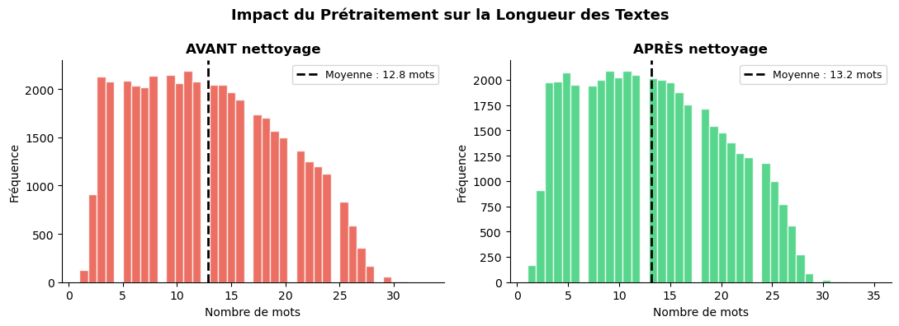
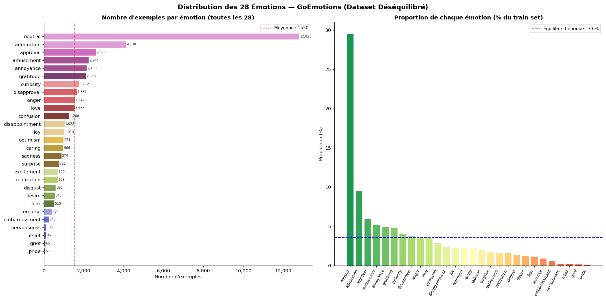
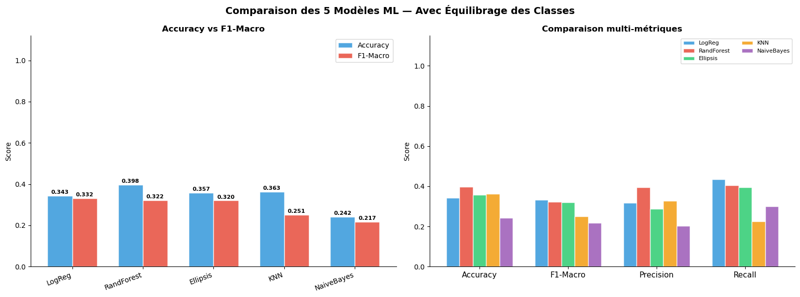
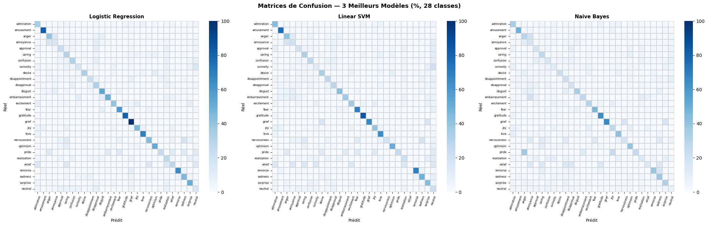

Readme · MD
# 🎭 Emotion Detection — GoEmotions
 
> Automatic emotion classification from English text using classical Machine Learning
> (TF-IDF + Linear SVM), trained on the **GoEmotions** dataset by Google Research.
 


 
---
 
## 📌 Overview
 
This project implements a complete **emotion detection pipeline** on Reddit comments:
data exploration, text preprocessing, TF-IDF vectorization, training and comparing
5 classifiers, evaluation on a held-out test set, and hyperparameter optimization
with GridSearchCV.
 
| | |
|---|---|
| **Dataset** | GoEmotions — Google Research |
| **Task** | Multi-class text classification |
| **Classes** | 28 emotions (incl. `neutral`) |
| **Dataset size** | ~54 000 Reddit comments (43 401 train / 5 426 val / 5 425 test) |
| **Language** | English |
| **Final model** | Linear SVM (`LinearSVC`, `C=0.01`, `class_weight='balanced'`) |
| **Test F1-Macro** | **0.344** |
| **Test Accuracy** | **0.390** |
 
> 28 fine-grained, highly imbalanced and often overlapping emotions make this a hard
> task: a random guess would score ~3.6 %. See [Results](#-results) for details and limits.
 
---
 
## 🗂️ Project Structure
 
```
emotion/
│
├── data/
│   ├── raw/                          # Original data from HuggingFace
│   │   ├── train.csv                 # Training split   (43 401 examples)
│   │   ├── val.csv                   # Validation split ( 5 426 examples)
│   │   ├── test.csv                  # Test split       ( 5 425 examples)
│   │   └── emotions.txt              # Label index → emotion name mapping
│   │
│   └── processed/                    # Cleaned and tokenized data
│       ├── train_clean.csv
│       ├── val_clean.csv
│       └── test_clean.csv
│
├── models/                           # Saved trained artifacts
│   ├── best_svm.joblib               # Best model (optimized LinearSVC)
│   └── tfidf_vectorizer.joblib       # TF-IDF vectorizer fitted on train set
│
├── notebooks/
│   ├── 01_data_exploration.ipynb     # Data loading, EDA, visualizations
│   ├── 02_preprocessing.ipynb        # Text cleaning, tokenization, TF-IDF
│   └── 03_model_training.ipynb       # Training, evaluation, GridSearchCV
│
├── figures/                          # All generated charts and plots
│
├── src/
│   ├── __init__.py
│   └── text_cleaner.py               # Reusable preprocess_text() function
│
├── run_pipeline.py                   # End-to-end prediction script
├── requirements.txt                  # Python dependencies
├── .gitignore
└── README.md
```
 
---
 
## ⚙️ Installation
 
### 1. Clone the repository
 
```bash
git clone https://github.com/wideddridi/emotion-detection-goemotions.git
cd emotion-detection-goemotions
```
 
### 2. Create a virtual environment
 
With conda:
 
```bash
conda create -n emotion python=3.10
conda activate emotion
```
 
Or with venv:
 
```bash
python -m venv .venv
source .venv/bin/activate        # Windows: .venv\Scripts\activate
```
 
### 3. Install dependencies
 
```bash
pip install -r requirements.txt
```
 
> **Note:** the saved models were trained with **scikit-learn 1.7.1**. Using another
> version may trigger an `InconsistentVersionWarning` or give different results, which is
> why the version is pinned in `requirements.txt`.
>
> The raw data is already included in `data/raw/`. Notebook 01 can also download it again
> from HuggingFace if needed.
 
---
 
## 🚀 Usage
 
### Quick demo (pre-trained model)
 
```bash
python run_pipeline.py
```
 
This loads the saved model and vectorizer and predicts the emotion of 10 example sentences.
 
### Use the model in your own code
 
```python
import joblib
from src.text_cleaner import preprocess_text
 
model = joblib.load("models/best_svm.joblib")
tfidf = joblib.load("models/tfidf_vectorizer.joblib")
 
# Label index -> emotion name
with open("data/raw/emotions.txt") as f:
    emotions = [line.strip() for line in f if line.strip()]
 
texts = [
    "I absolutely love this, it made my day!",
    "This is the worst experience ever, I'm furious.",
    "I'm scared of what might happen next.",
]
 
cleaned = [preprocess_text(t) for t in texts]
preds   = model.predict(tfidf.transform(cleaned))
 
for text, p in zip(texts, preds):
    print(f"{emotions[p]:<15} | {text}")
```
 
### Retrain from scratch
 
Run the notebooks **in order**, from the **project root** (each notebook starts with an
automatic `os.chdir()` fix):
 
```
Step 1 — notebooks/01_data_exploration.ipynb
         Loads GoEmotions, explores class distribution, text length, word clouds
         Saves raw splits to data/raw/
 
Step 2 — notebooks/02_preprocessing.ipynb
         Cleans text (lowercase, contractions, URLs, punctuation)
         Tokenizes and removes stopwords (keeping emotional words)
         Builds TF-IDF vectors (15 000 features)
         Saves cleaned data to data/processed/
         Saves vectorizer to models/tfidf_vectorizer.joblib
 
Step 3 — notebooks/03_model_training.ipynb
         Handles class imbalance with class_weight='balanced'
         Trains 5 ML models and compares them
         Optimizes the Linear SVM with GridSearchCV
         Saves best model to models/best_svm.joblib
```
 
---
 
## 🔬 ML Pipeline
 
### Step 1 — Text Cleaning
 
```
"I'm SO angry!!! http://example.com @user"
                 ↓  preprocess_text()
      "i am so angry"
```
 
Operations applied in order:
 
- Lowercase
- Expand contractions (`I'm` → `i am`, `won't` → `will not`, …)
- Remove URLs, @mentions, #hashtags, Reddit references (r/sub, u/user)
- Remove digits and punctuation
- Normalize whitespace

 
### Step 2 — Tokenization & Stopword Removal
 
Standard English stopwords are removed, **except emotionally significant words**
which are deliberately kept:
 
| Category | Examples kept |
|---|---|
| Negations | `not`, `no`, `never`, `nor`, `neither` |
| Intensifiers | `very`, `extremely`, `absolutely`, `really`, `deeply` |
| Contrasters | `but`, `however`, `although`, `despite`, `yet` |
 
> Keeping `not` and intensifiers is critical for emotion detection:
> `"not happy"` and `"extremely happy"` must remain distinct from `"happy"`.
 
### Step 3 — TF-IDF Vectorization
 
Each cleaned text is converted into a numerical vector of 15 000 dimensions:
 
```
["angry", "hate", "system"] → [0, 0.87, 0, 0.23, 0, ...]  (15 000 dims)
```
 
| Parameter | Value | Reason |
|---|---|---|
| `max_features` | 15 000 | Limits memory usage |
| `min_df` | 3 | Ignores very rare words |
| `max_df` | 0.90 | Ignores words in 90%+ of documents |
| `sublinear_tf` | True | Dampens high raw term frequencies |
| `ngram_range` | (1,1) | Unigrams only |
 
### Step 4 — Class Imbalance Handling
 
GoEmotions is heavily imbalanced:
 
```
neutral    →  32% of data   (most frequent)
grief      →   0.3% of data (rarest)
```
 
Without correction, the model would mostly predict `neutral`.
 
**Solution:** `class_weight='balanced'`
 
```
weight(class) = total_samples / (n_classes × samples_in_class)
 
neutral  → weight ≈ 0.3   (frequent  → low penalty)
grief    → weight ≈ 8.7   (rare      → high penalty if missed)
```
 

 
---
 
## 📊 Models Compared
 
| # | Model | Balancing strategy |
|---|---|---|
| 1 | Logistic Regression | `class_weight='balanced'` |
| 2 | Multinomial Naive Bayes | `sample_weight` in `.fit()` |
| 3 | Linear SVM ⭐ | `class_weight='balanced'` |
| 4 | Random Forest | `class_weight='balanced_subsample'` |
| 5 | k-Nearest Neighbors (k=7) | cosine distance |
 
### Why F1-Macro is the main metric
 
**F1-Macro** computes the F1-score separately for each of the 28 emotions,
then averages them. Rare emotions like `grief` count equally to frequent ones
like `neutral`, unlike Accuracy, which is misleading on imbalanced data.
 
### Optimization
 
The Linear SVM is further optimized using **GridSearchCV**
(3-fold cross-validation, scoring `f1_macro`):
 
```python
param_grid = {"C": [0.01, 0.1, 1.0, 5.0, 10.0]}
# best parameters: C = 0.01
```
 
---
 
## 📈 Results
 
All metrics are computed on the **held-out test set** (5 425 examples).
 
| Model | F1-Macro | Accuracy |
|---|---|---|
| **Linear SVM (optimized, C=0.01)** ⭐ | **0.344** | 0.390 |
| Logistic Regression | 0.332 | 0.343 |
| Random Forest | 0.322 | 0.398 |
| Linear SVM (default C) | 0.320 | 0.357 |
| k-NN (k=7) | 0.251 | 0.363 |
| Naive Bayes | 0.217 | 0.242 |
 

 
### Observations
 
- The optimized Linear SVM gives the best F1-Macro; GridSearchCV improved it by about
  +0.024 over the default SVM.
- Frequent and clearly expressed emotions are well detected (`gratitude` F1 ≈ 0.82,
  `amusement` ≈ 0.77, `love` ≈ 0.65, `remorse` ≈ 0.60).
- Rare or ambiguous emotions remain hard (`relief`, `pride`, `nervousness`, `grief`):
  very few examples, and balanced weights trade precision for recall.
- Close emotions are often confused (`annoyance` / `anger` / `disapproval`), as the
  confusion matrices show.

 
### Limitations & future work
 
- TF-IDF with unigrams ignores word order and context (sarcasm, irony).
- GoEmotions is multi-label by nature; this project keeps a single label per comment.
- Possible improvements: n-grams, word embeddings, fine-tuned transformers
  (BERT / RoBERTa), multi-label classification.
> Results may vary slightly depending on your machine and library versions.
 
---
 
## 📁 Dataset
 
| | |
|---|---|
| **Name** | GoEmotions |
| **Authors** | Google Research |
| **HuggingFace** | [google-research-datasets/go_emotions](https://huggingface.co/datasets/google-research-datasets/go_emotions) |
| **GitHub** | [goemotions/data](https://github.com/google-research/google-research/tree/master/goemotions/data) |
| **License** | Apache 2.0 |
 
### The 28 emotion classes
 
```
admiration    amusement     anger         annoyance     approval
caring        confusion     curiosity     desire        disappointment
disapproval   disgust       embarrassment excitement    fear
gratitude     grief         joy           love          nervousness
optimism      pride         realization   relief        remorse
sadness       surprise      neutral
```
 
---
 
## 👤 Author
 
**Dridi Wided** — [GitHub](https://github.com/wideddridi)

